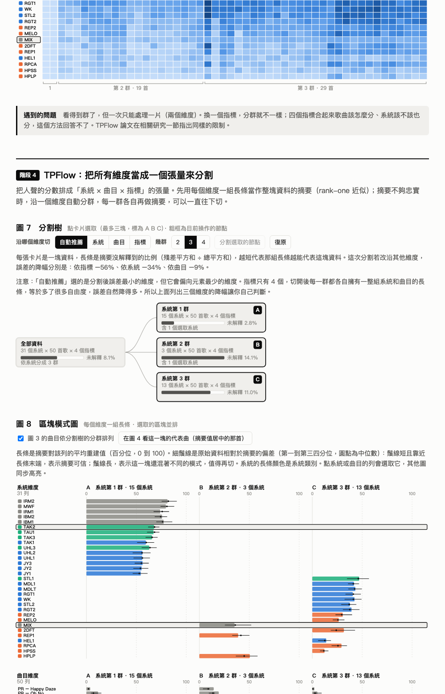

# SiSEC 2018 音樂分離評測：從連動視圖到張量分割

線上展示：<https://liying-c.github.io/sisec-tpflow-explorer/>

期末專案的展示版本。文中的 HW2 指同一份資料先前做的連動視圖作業，是這個專案的起點。

**一句話**：用視覺化弄懂 SiSEC 2018 的評測資料。先看懂四個指標，再用 TPFlow（Liu, Xu & Ren, IEEE TVCG 2019）的張量分割，找出系統和指標之間的結構。類型是 problem-driven design study。



> 階段 4 的畫面：分割樹沿系統切成 3 群（A、B、C），下方的區塊模式圖並排顯示三群在系統維度上的摘要長條與偏差鬚線。選取的 TAK2 與 MIX 在各圖同步高亮。直接開到這個狀態：`?p=03&sel=MIX,TAK2`。

### 為什麼從 HW2 走到 TPFlow

TPFlow 論文開頭批評的做法就是 HW2 的做法：多個連動視圖，沒有事先假設時只能手動一片一片切換找模式。所以頁面分四個階段，每一階段解決前一階段遇到的問題。

| 階段 | 做法 | 來源 | 遇到的問題 |
|---|---|---|---|
| 1. HW2 現況 | 連動視圖，一次看一個指標、一個 stem | HW2 | 4 個指標 × 5 個目標 = 20 片要手動切換，看完也記不住 |
| 2. 全部並排 | 四個指標的熱圖並排成 small multiples | 課堂第 6 週 Eyes beat memory | 不用靠記憶，但眼睛比不出結構 |
| 3. 單片分群 | 對一片熱圖做階層式分群並重排 | 課堂第 7 週 cluster heatmap | 一次只能處理兩個維度 |
| 4. TPFlow | 所有維度當成張量，自動摘要並建議往哪切 | TPFlow 論文 | 回答前三階段解決不了的問題 |

### 視圖

| 圖 | 階段 | 形式 | 互動 |
|---|---|---|---|
| 圖 1 排行榜、圖 3 曲目熱圖、圖 4 時間線 | 1 | 沿用 HW2 | 同 HW2；圖 3 可依分割樹的分群重排 |
| 圖 2 指標錨點圖 | 1 | 散佈圖，每個系統一個點，標出 MIX 與 oracle | 可換橫軸與縱軸的指標；點選系統 |
| 圖 5 四指標並排 | 2 | 四張列與欄完全相同的熱圖，顏色為百分位 | 點選系統與曲目 |
| 圖 6 分群熱圖 | 3 | 曲目依階層式分群重排，上方為樹狀圖 | 選擇切成 2 到 5 群 |
| 圖 7 分割樹 | 4 | 每張卡片是一塊子張量，長條為摘要沒解釋到的比例 | 選維度（或自動推薦）與群數後分割、復原；最多選三塊比較 |
| 圖 8 區塊模式圖 | 4 | 每個維度一組長條，選取的區塊並排，鬚線為偏差 | 點選系統與曲目；跳到代表曲 |

HW2 的方法地圖（MDS）與優勢圖（Hasse diagram）不在這條故事線上，收合在階段 1 的最後。

**連結是雙向的**：在分割樹沿曲目切，圖 3 的曲目依分群重排並畫出邊界；在任何圖選取系統或曲目，其他圖同步高亮，分割樹的卡片標出該塊包含幾個選取的系統。

**編碼原則**延續 HW2：色相只代表系統類別，分數只用一組藍色漸層，所以分割樹的偏差用長條長度而不是顏色表示，多個區塊用並排而不是不同顏色區分。

### 方法

階段 2 到 4 固定看人聲，因為只有人聲涵蓋全部 31 個系統（7 個盲分離系統只交了人聲與伴奏）。

**百分位轉換。** TPFlow 處理非負的計數資料，而 dB 分數有負值、四個指標尺度也不同。每個指標各自對「全部系統 × 50 首歌」的分數排名，值為 $(\text{名次} - 0.5)/n$，得到 31 × 50 × 4 = 6,200 格的非負張量。

**rank-one 摘要。** 把張量近似成每個維度一個非負單位向量的外積

$$
\mathcal{X} \approx \lambda \cdot \mathbf{a} \otimes \mathbf{b} \otimes \mathbf{c}
$$

$\mathbf{a}$、$\mathbf{b}$、$\mathbf{c}$ 分別是系統、曲目、指標維度的向量，用交替最小平方法求解。誤差是殘差平方和，除以總平方和就是「摘要沒解釋到的比例」。

**分割**（論文第 3.2 節）。對要切的維度：先做連續 rank-one 分解取前 3 組向量（第 1 組非負，之後對殘差再分解），該維度上每個元素得到一個 3 維特徵，用 k-means 分成 k 群，每群各自重做 rank-one 摘要。「自動推薦」對三個維度都試切，選分割後總誤差最小的。

**偏差**（論文第 4.2.3 節）。每個元素所有格子的「原始 − 重建」取第一、第二、第三四分位，畫成長條上的鬚線。

**與論文不同之處。** 偏差用絕對差而非相對差（百分位接近 0 時相對差會失真）；分群特徵乘上各組的強度 $\lambda$；k-means 用確定性的初始化（farthest-first），重新整理後結果相同；樹節點的大小不代表數值總和；沒有實作 OPTICS、地圖與流向圖。

### 目前的發現

以下為人聲、全部 31 個系統。

| 做法 | 結果 |
|---|---|
| 整塊資料只用一組摘要 | 8.1% 沒解釋到 |
| 沿指標切 2 群 | SDR 和 SIR 一群、SAR 和 ISR 一群，誤差降 36% |
| 沿系統切 3 群 | 誤差降 34%：強的 15 個、弱的 13 個，另有一小群 MIX、HPLP、REP1 |
| 沿曲目切 3 群 | 誤差只降 9%：較易 27 首、較難 21 首、兩首沒有人聲的純演奏曲 |

- **結構在系統和指標，不在歌曲。** 50 首歌主要是由難到易的連續變化，沒有明顯的類型。
- **MIX、HPLP、REP1 是「幾乎沒動混音」的系統**：SAR 和 ISR 高、SDR 和 SIR 低，和完全不分離的 MIX 行為一致。
- **指標可以這樣理解**：MIX 的 SAR 排第 1、SIR 排第 30，說明 SAR 量的是加工造成的瑕疵、SIR 量的是其他聲音漏進來多少；有 6 個系統的人聲 SDR 比 MIX 還低。MIX 的 ISR 排第 29，原因尚待釐清。
- **自動推薦有偏誤**：它永遠選指標維度，因為指標只有 4 個，切開後每一群各自擁有一整組系統和曲目的向量，自由度增加最多。頁面列出三個維度各自的降幅讓使用者判斷。

### 程式架構

演算法與畫面分開：計算全部在 Python 後端，Vue 只負責狀態、畫圖與互動。

```
瀏覽器（Vue 3 + D3，GitHub Pages）  ──  /api/*  ──▶  FastAPI（backend/sisec，Heroku）
        只保存狀態與分割樹的形狀                         無狀態：每次依請求重算
```

後端只依賴 numpy。numpy 當計算機用（陣列、索引、收縮、範數、排序、特徵分解），演算法的每一步都自己寫，對照論文的式子，不呼叫 scipy、scikit-learn 這類現成的實作。

| 檔案 | 內容 |
|---|---|
| `backend/sisec/data.py` | 讀 CSV，把分數整理成一個四維陣列 `scores[系統, 目標, 曲目, 指標]` |
| `backend/sisec/tensor.py` | 百分位轉換、非負 rank-one 分解（ALS）、連續分解、k-means、沿維度分割與推薦 |
| `backend/sisec/partition.py` | 一塊子張量的摘要：未解釋比例、各維度的模型值與偏差四分位、代表元素、再分割 |
| `backend/sisec/stats.py` | 中位數、相關距離、古典 MDS、Wilcoxon signed-rank test |
| `backend/sisec/graph.py` | 優勢圖：兩兩比較、顯著優於的邊、遞移化簡、分層 |
| `backend/sisec/cluster.py` | 階層式分群（average linkage） |
| `backend/sisec/views.py` | 把上面的結果組成各張圖需要的資料（哪些系統可見、依什麼排序、哪一塊張量） |
| `backend/sisec/api.py` | FastAPI 路由：驗證參數、缺值轉成 `null` |
| `src/api.js` | 前端的 API 用戶端；`null` 轉回 `NaN`、丟棄過期的回應 |
| `src/App.vue` | 狀態、網址參數、分割樹的形狀（每個節點記著三個維度的索引清單） |
| `src/components/*.vue` | 各張圖；圖 2 `MetricAnchor`、圖 5 `SmallMultiples`、圖 6 `ClusterHeatmap`、圖 7 `PartitionTree`、圖 8 `PatternBars` |

| 端點 | 用途 |
|---|---|
| `GET /api/meta` | 系統與曲目的屬性 |
| `POST /api/overview` | 階段 1：一個指標、一個 stem 的排行、分數矩陣、MDS、優勢圖 |
| `POST /api/stage` | 階段 2 到 4：人聲的列與欄、百分位張量、四指標中位數 |
| `POST /api/cluster` | 圖 6 的階層式分群 |
| `POST /api/partition/summary` | 分割樹一個節點的摘要 |
| `POST /api/partition/split` | 把一個節點沿某個維度（或自動推薦）切開 |

網址參數 `p=<維度><群數>`（維度 0 系統、1 曲目、2 指標）還原根節點的第一次分割，例如 `?p=13` 是沿曲目切 3 群。其餘參數同 HW2。

`npm run check` 執行前端的 node 測試與後端的 pytest（115 項）。除了合成資料的檢查（rank-one 張量誤差為 0、找回植入的兩群、自動推薦選到植入的維度等），還有 `backend/tests/golden/` 的基準比對：改寫前用原本的 JavaScript 實作在真實資料上輸出結果，Python 版逐項核對分群成員、誤差、優勢圖的邊與 MDS 座標，確保上面「目前的發現」的數字不變。

### 參考資料

- D. Liu, P. Xu, L. Ren. TPFlow: Progressive Partition and Multidimensional Pattern Extraction for Large-Scale Spatio-Temporal Data Analysis. IEEE TVCG 25(1), 2019. <https://ieeexplore.ieee.org/document/8440840>
- T. Munzner. Visualization Analysis and Design. CRC Press, 2014（課堂講義第 6、7 週）。

---

## 執行

需要 Node.js 與 [uv](https://docs.astral.sh/uv/)（Python 的套件管理工具）。

```bash
npm install
npm run api        # Python 計算後端，http://localhost:8000（第一次會自動安裝 numpy、FastAPI）
npm run dev        # 另開一個終端機：前端開發伺服器，/api 會轉給後端
npm run check      # 後端的 pytest
npm run build      # 打包前端到 dist/
```

### 部署

- **前端**：推到 master 時由 GitHub Actions 打包並部署到 GitHub Pages。後端網址由 repo 變數 `API_URL` 指定（打包時成為 `VITE_API_URL`）。
- **後端**：Heroku。推到 master 時，若 `backend/`、`public/data/` 或下列啟動檔有變動，同一個 workflow 會在測試通過後自動部署（需要 repo secret `HEROKU_API_KEY`）。repo 根目錄的 `Procfile`、`requirements.txt`、`.python-version` 是給 Heroku 用的。根目錄同時有 `package.json`，所以要明確指定 Python buildpack：

  ```bash
  heroku buildpacks:set heroku/python
  heroku config:set SISEC_ALLOW_ORIGINS=https://liying-c.github.io
  ```

  `requirements.txt` 由 `cd backend && uv export --no-dev --no-hashes --no-emit-project -o ../requirements.txt` 產生，改依賴後要重跑。

資料來源與引用見 `public/data/README.md`。程式碼以 MIT 授權。
